# 2026稳定高速VPN推荐20款性价比翻墙梯子使用指南

翻墙梯子（俗称机场）通常提供按流量与线路分档的代理订阅，配置方式和服务边界与商业VPN不同。下面整理20款服务的套餐与使用资料，帮助你比较预算、客户端、付款周期和用途；可按自己的使用场景对照选择。

收录：云猫科技、狗狗加速、尔湾云、XSUS、纵云梯、极客云、八戒、WgetCloud、WCloud、咖啡云、奶优、泡泡Dog、大哥云、星云、泰山、飞鸟、精灵学院、青云梯、好鸭、龙猫云。

资料更新：2026-10-29。欢迎通过Issue或Pull Request提交价格、入口和套餐纠错。

<b>目录：20款服务 · 点击展开</b>

[机场和VPN有什么区别](#vpn-vs-airport) · [云猫 CloudCat / 云猫科技](#service-01) · [狗狗加速 Doggygo](#service-02) · [尔湾云](#service-03) · [XSUS](#service-04) · [纵云梯](#service-05) · [极客云](#service-06) · [八戒](#service-07) · [WgetCloud](#service-08) · [WCloud](#service-09) · [咖啡云 CoffeeCloud](#service-10) · [奶优 NaiU_Net](#service-11) · [泡泡Dog](#service-12) · [大哥云](#service-13) · [星云](#service-14) · [泰山 TaiShan Net](#service-15) · [飞鸟 FlyingBird](#service-16) · [精灵学院 RioLU](#service-17) · [青云梯](#service-18) · [好鸭 NiceDuck](#service-19) · [龙猫云](#service-20) · [套餐对比总表](#directory) · [使用场景、预算与兼容性](#choose) · [评选标准](#methodology) · [维护与更新](#maintenance) · [常见问题](#faq) · [资料来源](#sources)

## 机场和 VPN 有什么区别，该选哪个

商业VPN通常用服务商自己的App连接；机场通常把一批代理节点打包成订阅，导入兼容客户端使用，也有专属App。区别不在技术名词，在你实际会碰到什么：

| 比较项 | 商业VPN | 机场／代理订阅 |
|---|---|---|
| 使用方式 | 通常安装官方App | 通用客户端或专属App，按本家教程配置 |
| 套餐 | 比较实付周期、设备数和功能 | 比较实付周期、配额、倍率和节点范围 |
| 可用性 | 取决于服务、协议与当地网络 | 取决于节点、线路与当地网络 |
| 分流 | 看App支持的规则 | 看客户端与订阅格式，可按支持范围设置 |

想少配置，先看专属App；看视频或用AI工具，先确认目标平台和地区；准备接路由器，先核对协议和固件支持。初次使用优先比较短周期方案，再决定是否长期订阅。

---

## 20款机场VPN推荐与套餐

## 01 · 云猫科技 CloudCat-VPN

核心优势：专为跨网限速设计的全智能接入。晚高峰吞吐极度稳定，对跨网络运营商丢包有特效，低调且人均带宽充裕。

服务规格：100% 解锁 OpenAI / Gemini / Netflix，体验非常好。

[→ 云猫 CloudCat / 云猫科技 官网注册入口](https://cloud.yuncat.net/#/register?code=GVJT1ONh)

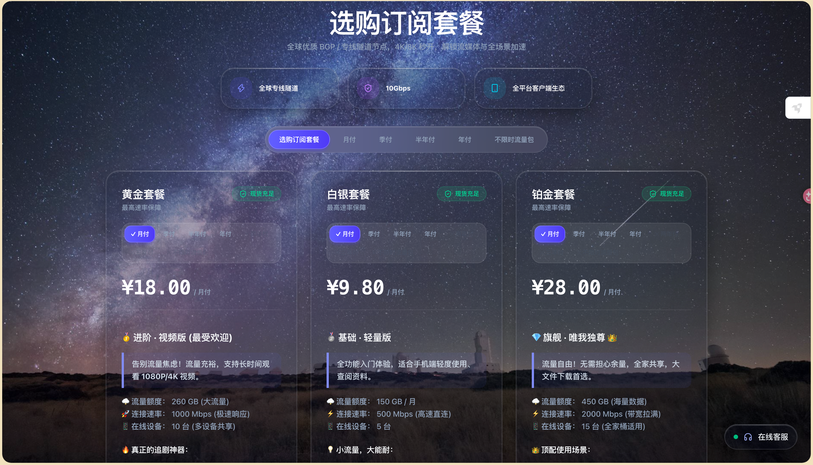

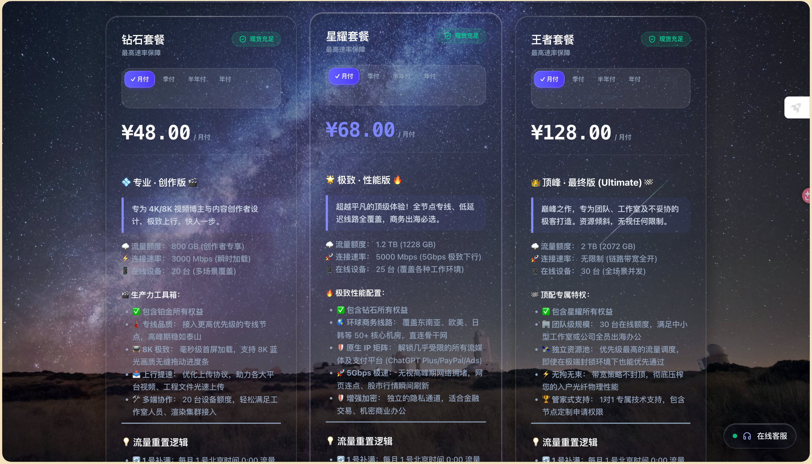

*云猫商店实图，用户于2026-10-29提供；页面内的带宽与解锁文字为商家标称。*

### 主要特点包括

- **两种计费方式**：周期月付和一次性不限时包分别提供。
- **设备分档**：月付允许5—30台设备同时在线，随档位增加。
- **配置路线**：商店列有VLESS／XHTTP说明，按所选系统配置。
- **流量重置**：周期方案每月1日补满，不限时包不按月补。
- **配额选择**：白银、黄金覆盖基础用量，高档主要增加流量与设备额度。

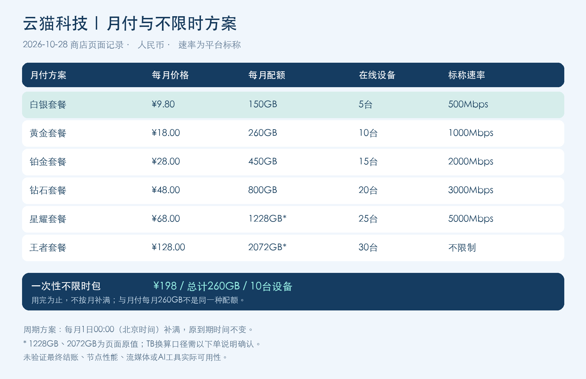

### 套餐详情介绍

月付与不限时方案（2026-10-28）：

| 套餐 | 月付价格 | 每月配额 | 在线设备 | 页面标称速率 |
|---|---:|---|---|---|
| 白银套餐 | ¥9.80 | 150GB | 5台 | 500Mbps |
| 黄金套餐 | ¥18.00 | 260GB | 10台 | 1000Mbps |
| 铂金套餐 | ¥28.00 | 450GB | 15台 | 2000Mbps |
| 钻石套餐 | ¥48.00 | 800GB | 20台 | 3000Mbps |
| 星耀套餐 | ¥68.00 | 1228GB* | 25台 | 5000Mbps |
| 王者套餐 | ¥128.00 | 2072GB* | 30台 | 页面标示不限制 |

| 一次性方案 | 价格 | 总流量 | 在线设备 | 有效期 |
|---|---:|---|---|---|
| 不限时铂金套餐 | ¥198.00 | 260GB，一次性总量 | 10台 | 页面说明不限时间，用完为止 |

\* 星耀和王者的官网同时列有TB与GB两种数字，换算口径不一致。这里保留页面的GB值，买这两档前请确认实际到账配额。

### 套餐选购建议

白银和黄金是两个基础选择。铂金28元450GB，钻石48元800GB，主要增加配额和在线设备额度；高档方案先确认自己是否用得上。

VLESS／XHTTP及各系统配置见站内教程。周期套餐每月1日北京时间00:00补满，套餐到期日不变；198元不限时包给的是总计260GB，用完为止，不按月补满。

### 客户端与使用说明

商店列有VLESS／XHTTP说明，各系统配置按站内教程操作。

---

## 02 · 狗狗加速-VPN

狗狗加速目前已经全面上线Hysteria2协议；不同于hy1，hy2全面优化了链接速度(0-RTT)，进一步降低延迟；同时使用全新的带宽控制方式；协议与客户端按所选套餐配置。

[→ 狗狗加速 Doggygo 官网注册入口](https://www.dginv.click/#/register?code=HeViR3vJ)

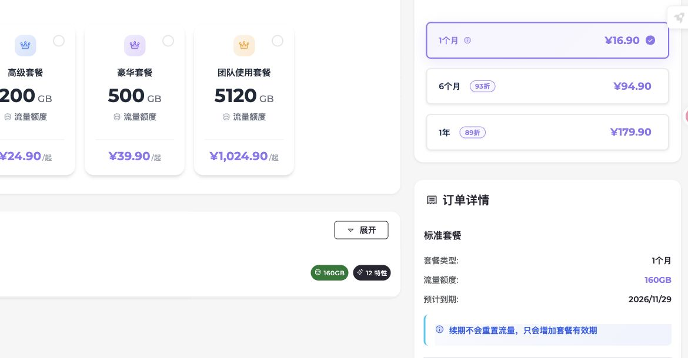

*狗狗加速套餐页，2026-10-29截图。*

### 主要特点包括

- **多协议配置**：标准规格列anytls、hysteria2、mieru、naive、vmess。
- **个人设备额度**：标准档限1人2台设备，禁止多人共享。
- **购买周期**：已核对一个月、半年和一年的标准档金额。
- **标称速率**：当前标准档限速100M，与旧文章参数不同。
- **移动端入口**：登录页有官方App Store入口和移动应用说明。

### 套餐详情介绍

套餐价格（2026-10-29）：

| 套餐 | 页面价格 | 付款周期 | 流量口径 | 补充说明 |
|---|---:|---|---|---|
| 标准套餐 | ¥16.9 | 1个月 | 160GB | 1人2设备；标称100M |
| 标准套餐半年 | ¥94.9 | 6个月 | 160GB配额 | 周期内重置见订单规则 |
| 标准套餐年付 | ¥179.9 | 1年 | 160GB配额 | 周期内重置见订单规则 |

### 套餐选购建议

标准档列出的协议有anytls、hysteria2、mieru、naive和vmess，登录页有官方App Store入口。具体选哪个客户端，按对应协议的教程配置。

这档禁止多人共享，流量在订单日清空。续期只延长有效期，不重置当前流量；平台也明确写了不承诺速度、不支持退款。高级200GB、豪华500GB等方案的具体周期报价，请在购买页切换查看。

### 客户端与使用说明

标准规格列出anytls、hysteria2、mieru、naive、vmess。登录页有官方App Store入口及移动应用说明，不代表所有客户端都支持全部协议。

---

## 03 · 尔湾云-VPN

选择机场时，客户端兼容性要先确认。尔湾云当前推荐UniClash，并保留第三方配置说明。2024 年上线，节点铺在马来西亚、韩国、法国、香港、日本、台湾等 8 个国家和地区，SS、V2Ray 双协议订阅，具体客户端兼容性以当前教程为准。

入门档24.99元／30天起，往上到旗舰版Max为119.99元／30天，中间几档按流量和速度线性拉开差距。参考原文介绍Netflix、TVB等流媒体和ChatGPT访问，不同档位的具体可用节点仍按当前套餐核对。年付优惠另看结账页，本文不沿用未经本轮确认的折扣码。

[→ 尔湾云 官网注册入口](https://ewanwtt.net/auth/register?code=QkcUwp)

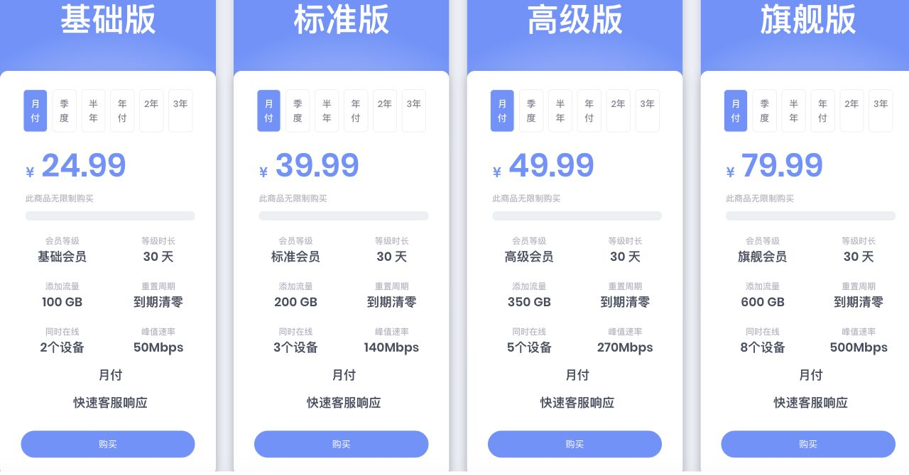

*尔湾云套餐页，2026-10-29截图。*

### 主要特点包括

- **分档套餐**：基础、标准、高级、旗舰和旗舰Max。
- **多设备选择**：在线设备额度从2台增加到10台。
- **配额跨度**：普通档覆盖100GB—1200GB，按需求升级。
- **专属客户端**：后台当前推荐UniClash。
- **系统与配置**：保留第三方配置说明，兼容性可能随协议调整。

### 套餐详情介绍

套餐价格（2026-10-28）：

| 套餐 | 页面价格 | 付款周期 | 流量口径 | 补充说明 |
|---|---:|---|---|---|
| 基础版 | ¥24.99 | 30天 | 100GB | 2设备；标称50Mbps |
| 标准版 | ¥39.99 | 30天 | 200GB | 3设备；标称140Mbps |
| 高级版 | ¥49.99 | 30天 | 350GB | 5设备；标称270Mbps |
| 旗舰版 | ¥79.99 | 30天 | 600GB | 8设备；标称500Mbps |
| 旗舰版Max | ¥119.99 | 30天 | 1200GB | 10设备；标称500Mbps |

### 套餐选购建议

两台设备、100GB以内的用量，可以先看基础档；超过两台同时在线，就往标准档以上比较。表内标称速率也是各档差异之一。

官方当前推荐UniClash，并提醒第三方客户端兼容性可能变化。普通月付按30天计、到期清零；如果已有套餐，折算余额和原路退款是两回事。

### 客户端与使用说明

当前后台推荐UniClash专属客户端，并提示第三方兼容性可能变化。已有固定路由器或通用客户端配置的读者，先确认是否接受这条配置路线。

---

## 04 · XSUS-VPN

XSUS-VPN是国际专线传输网络，多运营商优化连接，主打流媒体及ChatGPT访问；客户端方面支持Clash、sing-box、Shadowrocket、Loon等通用客户端导入订阅链接；支付方式支持支付宝和微信。

[→ XSUS 官网注册入口](https://xsus.cloud/register?code=Zkm9Qh54)

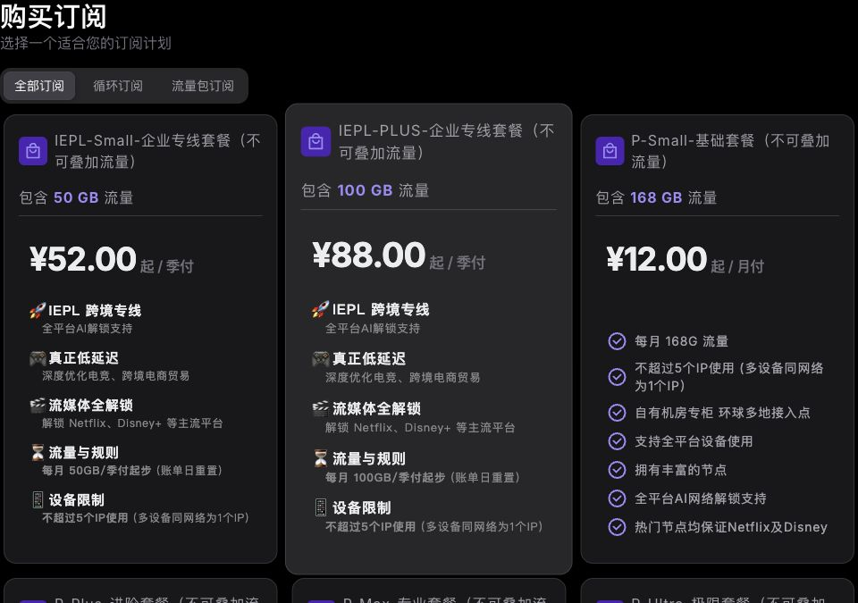

*XSUS套餐页，2026-10-29截图。*

### 主要特点包括

- **普通月付**：四档覆盖168GB、336GB、420GB和1024GB。
- **IEPL产品线**：季度付款，按每月50GB或100GB给配额。
- **按量使用**：有一次性不限时流量包。
- **按IP计数**：最多5个IP，同一网络多设备按1个IP计算。
- **客户端导入**：有Clash、sing-box、Shadowrocket、Loon等入口。

### 套餐详情介绍

套餐价格（2026-10-28）：

| 套餐 | 页面价格 | 付款周期 | 流量口径 | 补充说明 |
|---|---:|---|---|---|
| P-Small | ¥12 | 月付起 | 168GB/月 | — |
| P-Plus | ¥24 | 月付起 | 336GB/月 | — |
| P-Max | ¥30 | 月付起 | 420GB/月 | — |
| P-Ultra | ¥70 | 月付起 | 1024GB/月 | — |
| IEPL-Small | ¥52 | 季付起 | 50GB/月 | — |
| IEPL-PLUS | ¥88 | 季付起 | 100GB/月 | — |
| P-188G | ¥65 | 一次性 | 188GB总量 | — |
| P-400G | ¥122 | 一次性 | 400GB总量 | — |

### 套餐选购建议

普通月付适合按月用量比较；IEPL-Small的52元是季度付款，每月配额50GB，和12元的普通月付不是同一条产品线。一次性包也要单独看总量。

连接限制写的是最多5个IP，同一网络多设备按1个IP算。月流量不结转，一次性包重复购买会重置、不叠加；购买须知明确无法原路退款。面板有Clash、sing-box、Shadowrocket和Loon等导入入口。

### 客户端与使用说明

面板有Clash、sing-box、Shadowrocket、Loon导入及Windows、Android、macOS、iOS客户端下载入口。

---

## 05 · 纵云梯-VPN

参考文章对纵云梯的介绍是：“纵云梯是一家新机场，个人体验了一下速度还不错，客服响应也比较快。”

当前购买页可自行组合流量和设备数，月度配额在10—500GB之间调整，默认100GB、3设备的月付为52.5元；其他组合按页面报价。

[→ 纵云梯 官网注册入口](https://zongyunti.com/?r=249921)

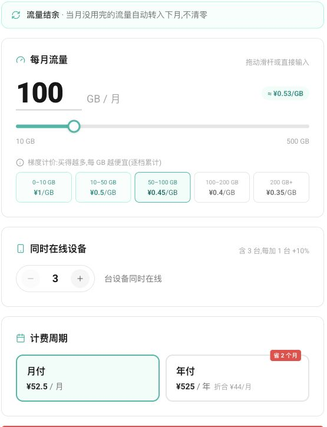

*纵云梯套餐配置页，2026-10-29截图。*

### 主要特点包括

- **可配置流量**：滑杆范围10—500GB／月。
- **设备可增加**：默认3台，每加1台费用加10%。
- **默认报价**：100GB、3设备组合可按月或按年付款。
- **成本透明对照**：年付525元为总额，月均43.75元。
- **使用支持**：面板有macOS教程和工单入口。

### 套餐详情介绍

套餐价格（2026-10-28）：

| 套餐 | 页面价格 | 付款周期 | 流量口径 | 补充说明 |
|---|---:|---|---|---|
| 默认100GB、3设备 | ¥52.5 | 月付 | 100GB/月 | 默认配置，并非最低起售价 |
| 默认100GB、3设备 | ¥525 | 年付 | 100GB/月 | 精确折合43.75元/月 |

### 套餐选购建议

这类买法适合已经知道自己月用量、希望自己搭配配额的人。默认含3台设备，每加1台价格增加10%。年付525元是一次付款总额，月均43.75元，页面约44元/月是取整展示。

面板有macOS教程和工单入口，其他系统先对照当前文档再配置。

### 客户端与使用说明

面板提供macOS教程和工单支持入口。其他系统与具体协议按当前教程核对。

---

## 06 · 极客云-VPN

极客云（JikeCloud），又称极客零（Jike0），采用会员分档订阅，成立于2017年，拥有近70个付费节点。原文介绍使用CN2/BGP隧道中转和IPLC国际专线，提供灵活的套餐和高性价比的服务，适合各类用户需求。 当前首页提示SSR已下架，商品卡仍有旧字样，实际协议以当前教程为准。

[→ 极客云 官网注册入口](https://jikefind.net/auth/register?code=cUC2)

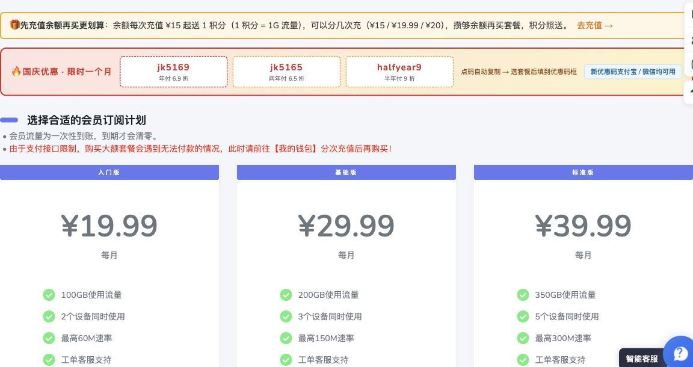

*极客云套餐页，2026-10-29截图。*

### 主要特点包括

- **节点分层**：会员等级影响可使用的节点范围。
- **IPLC方案**：旗舰版及以上列有IPLC专线节点。
- **设备分档**：入门2台，最高档10台。
- **配额分档**：五档从100GB到1200GB。
- **客户端下载**：当前推荐UniClash，另有iOS与第三方教程。

### 套餐详情介绍

套餐价格（2026-10-29）：

| 套餐 | 页面价格 | 付款周期 | 流量口径 | 补充说明 |
|---|---:|---|---|---|
| 入门版 | ¥19.99 | 月付 | 100GB | 2设备；标称60M |
| 基础版 | ¥29.99 | 月付 | 200GB | 3设备；标称150M |
| 标准版 | ¥39.99 | 月付 | 350GB | 5设备；标称300M |
| 旗舰版 | ¥59.99 | 月付 | 600GB | 8设备；标称不限速 |
| 旗舰版大流量 | ¥99.99 | 月付 | 1200GB | 10设备；标称不限速 |

### 套餐选购建议

先看自己要用的节点等级，再选容量。入门、基础、标准并不包含旗舰的全部节点，设备限制也从2台逐档增加。

官方目前推荐UniClash，提供Windows、Mac和Android版本，另有iOS及第三方教程。需要注意，首页写SSR已经下架，商品卡却还保留SSR/V2ray字样；选客户端前问清当前支持的协议。长周期流量也请看具体订单分配规则。

### 客户端与使用说明

首页推荐UniClash，提供Windows、macOS ARM/Intel及Android下载，并保留第三方与iOS教程入口。

---

## 07 · 八戒-VPN

参考文章介绍：“八戒机场不光是有魔戒的流量包，也推出了月付套餐。”

当前既有按月配额，也有一次性不限时总量包，另有1元1GB、30天有效的体验方案。规律使用可以比较月付，低频备用则按总量计算；独享IP和动态家宽为另购产品。

[→ 八戒 官网注册入口](https://bajie.la/register?aff=TmMKqKpo)

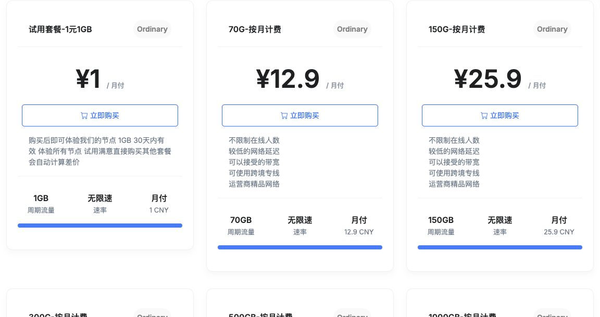

*八戒套餐页，2026-10-29截图。*

### 主要特点包括

- **体验方案**：1元1GB，30天有效。
- **周期月付**：从70GB起，按月度需求升级。
- **不限时包**：一次购买总量，用量不规律时可单独比较。
- **另购产品**：独享机房IP和动态家宽不包含在普通套餐内。
- **使用入口**：导航提供客户端和使用文档。

### 套餐详情介绍

套餐价格（2026-10-28）：

| 套餐 | 页面价格 | 付款周期 | 流量口径 | 补充说明 |
|---|---:|---|---|---|
| 体验包 | ¥1 | 一次购买 | 1GB总量 | 30天有效 |
| 70G月付 | ¥12.9 | 月付 | 70GB/月 | — |
| 150G月付 | ¥25.9 | 月付 | 150GB/月 | — |
| 300G月付 | ¥38.9 | 月付 | 300GB/月 | — |
| 500G月付 | ¥51.9 | 月付 | 500GB/月 | — |
| 100G不限时 | ¥34.8 | 一次性 | 100GB总量 | — |
| 220G不限时 | ¥70.8 | 一次性 | 220GB总量 | — |
| 390G不限时 | ¥118.8 | 一次性 | 390GB总量 | — |

### 套餐选购建议

新用户可以先比较1元体验包；日常主用看月付，偶尔用则把一年总用量和不限时包价格放一起算。独享机房IP、动态家宽是另外购买的产品，不属于普通方案。

更换套餐会覆盖当前套餐，已有订阅时尤其要看清。下方使用当前可访问的注册地址，邀请绑定仍未实测。客户端下载与配置按站内文档走。

### 客户端与使用说明

导航提供客户端下载和使用文档；独享IP、动态家宽按对应产品教程配置，不能直接套用普通套餐配置。

---

## 08 · WgetCloud-VPN

国内多线BGP接入与亚马逊 Global Accelerator 专线加速的双层架构，是 WgetCloud 区别于多数同类机场的技术基底。原文还介绍了节点负载与自营机房，但未提供可供本文复核的测速记录，因此不沿用具体实测延迟。

[→ WgetCloud 官网注册入口](https://invite.wgetcloud.ltd/auth/register?code=GC5hfB)

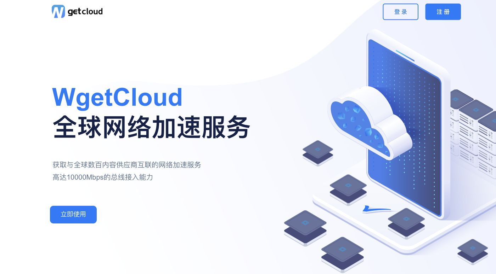

*WgetCloud官网首页，2026-10-29截图。*

### 主要特点包括

- **三级资源**：基础、优质、精品按配额与节点范围分档。
- **整期购买**：季付90天，年付页面标360天。
- **连接额度**：分别列在线公网IP及并发连接数。
- **地区差别**：精品方案另外列出更多地区节点。
- **客服时间**：北京时间9:00—24:00，支持范围按帮助文档。

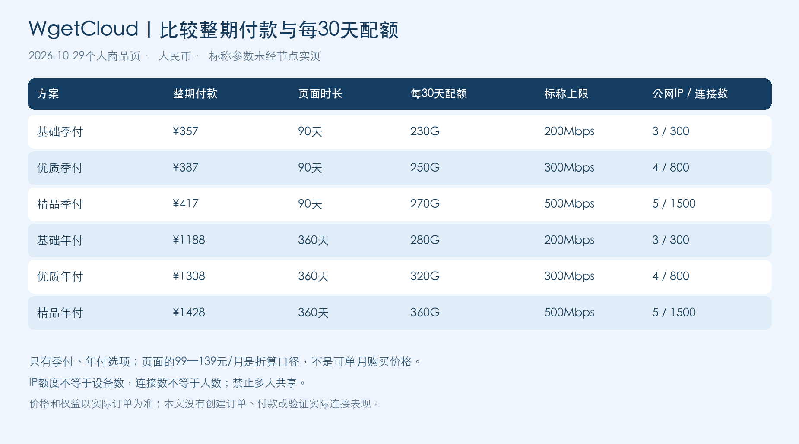

### 套餐详情介绍

套餐价格（2026-10-29）：

| 方案 | 整期实付 | 页面时长 | 页面折合月价 | 每30天配额 | 标称上限 | 在线公网IP／并发连接 |
|---|---:|---|---:|---|---|---|
| 基础季付 | ¥357 | 90天 | ¥119 | 230G | 200Mbps | 3／300 |
| 优质季付 | ¥387 | 90天 | ¥129 | 250G | 300Mbps | 4／800 |
| 精品季付 | ¥417 | 90天 | ¥139 | 270G | 500Mbps | 5／1500 |
| 基础年付 | ¥1188 | 360天 | ¥99 | 280G | 200Mbps | 3／300 |
| 优质年付 | ¥1308 | 360天 | ¥109 | 320G | 300Mbps | 4／800 |
| 精品年付 | ¥1428 | 360天 | ¥119 | 360G | 500Mbps | 5／1500 |

### 套餐选购建议

年付基础档实付1188元、页面时长360天，每30天280G。三个等级的IP和并发连接额度不同，选档时除了配额，也要考虑自己的连接方式。峰值带宽不是SLA保证带宽。

3个在线公网IP不等于3台设备；同一Wi-Fi下多设备可能共用公网IP，但仍共享连接额度。平台禁止多人共享，标注新疆地区不可用。售后主要协助Clash核心应用、OpenWRT、Surfboard、ssrray和Shadowrocket，Linux暂不提供协助，在线客服时间为北京时间9:00—24:00。

公开帮助文档说明没有免费试用，“不停机”和“竞速场”已不再提供，旧订单看自身权益。购买前需要完成邮箱验证。

### 客户端与使用说明

帮助文档主要协助Clash核心应用、OpenWRT、Surfboard、ssrray和Shadowrocket，Linux暂不提供协助。安装与导入按所选客户端的官方教程操作。

---

## 09 · WCloud-VPN

整体定位偏向高性价比与稳定长期使用。主打多入口网络架构 + 高速专线节点 + 高性价比套餐，在稳定性和价格之间取得了不错的平衡，其采用 多入口智能调度网络，通过自动分配最佳接入线路来降低延迟，并提供 最高3000Mbps突发带宽，官方承诺 99.9% SLA可用率。原文介绍中，其节点覆盖超过 50+国家地区、70+服务器节点，包括美国、日本、新加坡、香港、欧洲等热门区域，同时也包含一些相对冷门的优化节点，适合不同网络环境的用户使用。主打日常浏览、流媒体观看和AI工具访问。套餐定价处于当前市场中低价区间，同时提供不同流量档位与一次性流量包，适合从轻度到重度用户按需选择。

[→ WCloud 官网注册入口](https://www.weidu1.com/#/register?code=4JyZlfdr)

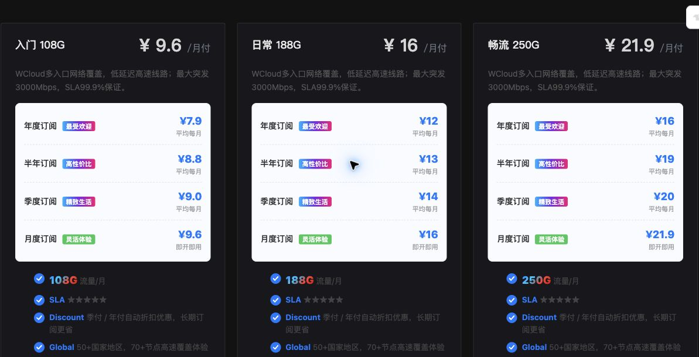

*WCloud套餐页，2026-10-29截图。*

### 主要特点包括

- **低预算月付**：9.6元108GB起，后续按配额增加。
- **不限时总量**：250GB、700GB、1200GB和1888GB。
- **周期选择**：长周期折合价与单月实际付款分开比较。
- **文档与导入**：面板有使用文档和订阅导入入口。
- **售后资料**：公告指向weidu5.net教程与常见问题。

### 套餐详情介绍

套餐价格（2026-10-29）：

| 套餐 | 页面价格 | 付款周期 | 流量口径 | 补充说明 |
|---|---:|---|---|---|
| 入门108G | ¥9.6 | 月付 | 108GB/月 | — |
| 日常188G | ¥16 | 月付 | 188GB/月 | — |
| 畅流250G | ¥21.9 | 月付 | 250GB/月 | — |
| 巅峰580G | ¥46 | 月付 | 580GB/月 | — |
| 不限时基础包 | ¥56 | 一次性 | 250GB总量 | — |
| 不限时扩容包 | ¥149 | 一次性 | 700GB总量 | — |
| 不限时尊享包 | ¥249 | 一次性 | 1200GB总量 | — |
| 不限时狂飙包 | ¥299 | 一次性 | 1888GB总量 | — |

### 套餐选购建议

想控制月付预算，先看108GB和188GB两档；只是偶尔备用，可以另算一次性包。年付页面展示的月均价不能当作可逐月付款的价格。

WCloud产品卡明确无退款服务，教程与常见问题入口是weidu5.net。配置前按官方文档确认客户端。

### 客户端与使用说明

面板有使用文档与订阅导入入口，并在公告中链接weidu5.net作为教程与常见问题入口。

---

## 10 · Coffee Cloud 咖啡云-VPN

咖啡云（Coffee Cloud）运营多年，主营公网隧道中转，也提供少量 IEPL 专线节点。套餐以咖啡命名，价位整体偏低，具体档位见下方价格表。

协议方面，除常规的 Shadowsocks 与 AnyTLS 外，还提供自研的 V-Ninja；V-Ninja 需导入官方专用客户端才能使用，不想额外装客户端用 Shadowsocks 订阅即可。支付方式为支付宝与 USDT。

[→ 咖啡云 CoffeeCloud 官网注册入口](https://aicoffee.app/#/register?code=yplZVh8v)

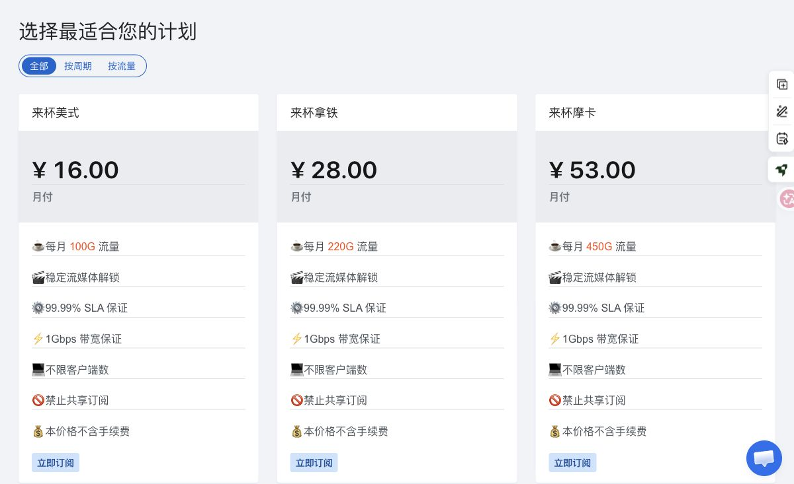

*咖啡云套餐页，2026-10-29截图。*

### 主要特点包括

- **咖啡系列套餐**：美式、拿铁、摩卡、澳白四档。
- **配额范围**：每月100GB—700GB。
- **个人多设备**：页面列不限客户端数，禁止共享订阅。
- **协议配置**：有官方自研协议及iOS客户端说明。
- **付款口径**：表内金额不含手续费，按结账总额比较。

### 套餐详情介绍

套餐价格（2026-10-28）：

| 套餐 | 页面价格 | 付款周期 | 流量口径 | 补充说明 |
|---|---:|---|---|---|
| 来杯美式 | ¥16 | 月付 | 100GB/月 | — |
| 来杯拿铁 | ¥28 | 月付 | 220GB/月 | — |
| 来杯摩卡 | ¥53 | 月付 | 450GB/月 | — |
| 来杯澳白 | ¥78 | 月付 | 700GB/月 | — |

### 套餐选购建议

100GB以内先看美式，200GB左右看拿铁，后面两档主要增加配额。视频、文件下载和软件更新都会占流量，选档时可以留一点余量。

页面写不限客户端数，但禁止共享订阅，而且价格不含手续费。官方有自研协议及iOS客户端说明，是否需要专用客户端要看所选协议。

### 客户端与使用说明

页面有使用文档和订阅导入入口，公告介绍官方自研协议及iOS客户端。不同协议是否需要专用客户端，以对应教程为准。

---

## 11 · 奶优 NaiU_Net-VPN

NaiU_Net-VPN是一家成立于2023年10月的代理订阅服务，使用深港IEPL专线，提供稳定的网络连接。该服务支持SS协议，并支持UDP，适合游戏和流媒体使用。

[→ 奶优 NaiU_Net 官网注册入口](https://www.naiunet.com/#/register?code=FdRsnsTY)

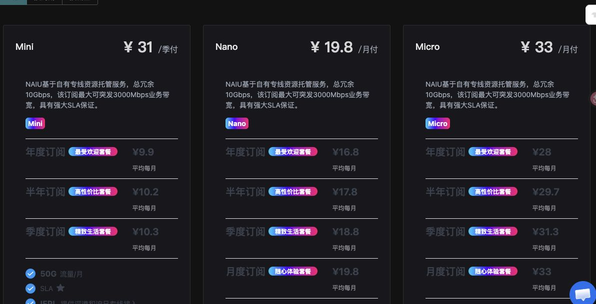

*奶优套餐页，2026-10-29截图。*

### 主要特点包括

- **小流量入门**：Mini为季付，每月50GB。
- **普通月付**：Nano到Large逐档增加配额。
- **高用量选择**：最高档提供1500GB／月。
- **订阅配置**：面板提供使用文档与导入入口。
- **续费规则**：同等级续费延长时间，当前流量不直接叠加。

### 套餐详情介绍

套餐价格（2026-10-28）：

| 套餐 | 页面价格 | 付款周期 | 流量口径 | 补充说明 |
|---|---:|---|---|---|
| Mini | ¥31 | 季付 | 50GB/月 | 并非约10元可单月购买 |
| Nano | ¥19.8 | 月付 | 100GB/月 | — |
| Micro | ¥33 | 月付 | 200GB/月 | — |
| Small | ¥45.1 | 月付 | 350GB/月 | — |
| Medium | ¥70.4 | 月付 | 700GB/月 | — |
| Large | ¥121 | 月付 | 1500GB/月 | — |

### 套餐选购建议

Mini适合小流量、能接受季度付款的用法；想逐月付就从Nano看起。年付月均价可以拿来算长期成本，但别和当月实际付款额混在一起。

仅限账户持有者使用。续费公告提醒，同等级续费叠加时间、流量不叠加，流量包覆盖且不补偿；换套餐前看清结账说明。

### 客户端与使用说明

面板提供使用文档与订阅导入；IEPL、突发带宽和流媒体描述均为平台自述，不是本文的线路或解锁测试。

---

## 12 · 泡泡Dog-VPN

**泡泡Dog-VPN** 成立于2022年，专注于提供稳定的网络加速服务。该平台使用 **大陆国际专线传输网络**，支持 **IPLC专线**，通过 **多运营商优化连接** 技术，以高速与稳定作为卖点。原文介绍其支持包括 **Netflix** 等热门平台。同时介绍了 **ChatGPT** 访问支持。

**泡泡Dog-VPN** 采用了 **secure加密隧道** 技术，作为其线路描述；本文未独立验证相应安全与隐私效果。平台支持 **支付宝** 和 **微信支付**，为用户提供便捷的支付方式。

[→ 泡泡Dog 官网注册入口](https://paopaogou.co/#/register?code=g4DTM096)

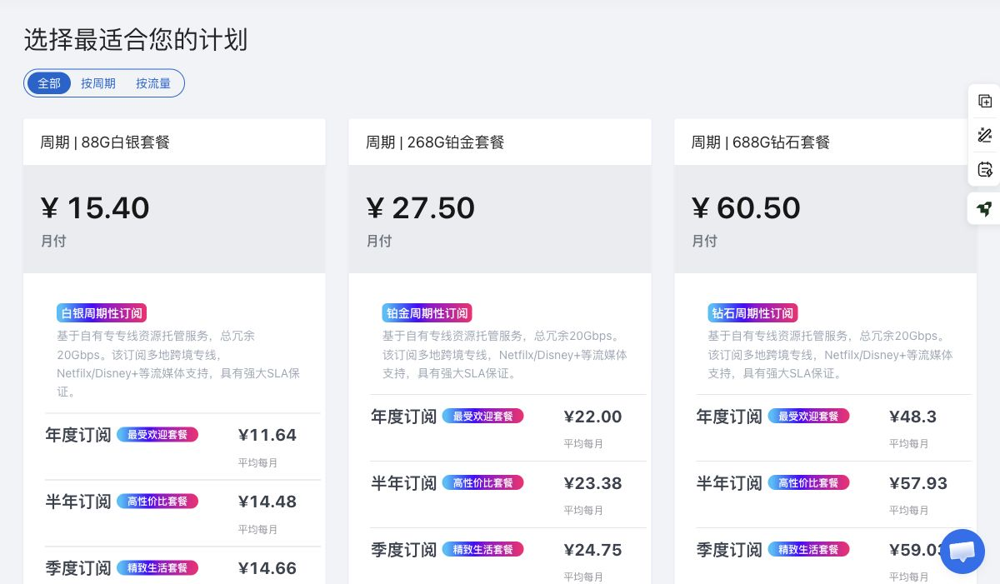

*泡泡Dog套餐页，2026-10-29截图。*

### 主要特点包括

- **三档常规方案**：白银88GB、铂金268GB、钻石688GB。
- **年度总量方案**：888GB一次到账，一年内用完。
- **设备额度**：铂金和钻石列10台同时在线。
- **协议说明**：相关商品卡标ShadowsocksObfs。
- **活动库存**：秋季限定可能下架，不当作常年固定权益。

### 套餐详情介绍

套餐价格（2026-10-28）：

| 套餐 | 页面价格 | 付款周期 | 流量口径 | 补充说明 |
|---|---:|---|---|---|
| 白银 | ¥15.4 | 月付 | 88GB/月 | — |
| 铂金 | ¥27.5 | 月付 | 268GB/月 | 卡片列10设备同时用 |
| 钻石 | ¥60.5 | 月付 | 688GB/月 | 卡片列10设备同时用 |
| 秋季限定 | ¥116.6 | 年付 | 总计888GB | 一次到账，1年内用完 |

### 套餐选购建议

月用量比较规律，先选白银、铂金或钻石；用量集中在少数月份，再算年度总量包。116.60元的888GB是一整年的总量，不是每月888GB。

铂金和钻石卡片列10台设备同时使用，其他方案看各自说明。相关卡片标注ShadowsocksObfs；秋季限定方案可能下架，以购买页为准。

### 客户端与使用说明

铂金、钻石及年度卡片标示ShadowsocksObfs，并有全平台客户端说明；具体版本按文档核对。

---

## 13 · 大哥云-VPN

大哥云-VPN 是 2020 年上线的 Trojan 协议机场，在同类服务中运营时间偏长；节点覆盖香港、台湾、日本、新加坡、韩国、泰国、越南、菲律宾、美国、英国等国家和地区，支持 Netflix、Disney+、TikTok 等主流流媒体解锁。提供 Windows、macOS、iOS、Android 全平台自研客户端，也支持 V2Ray 订阅链接一键导入，设备限制以当前套餐为准；支付方式支持支付宝与微信。

[→ 大哥云 官网注册入口](https://a03.dgy02.com/#/register?code=jJTv35WG)

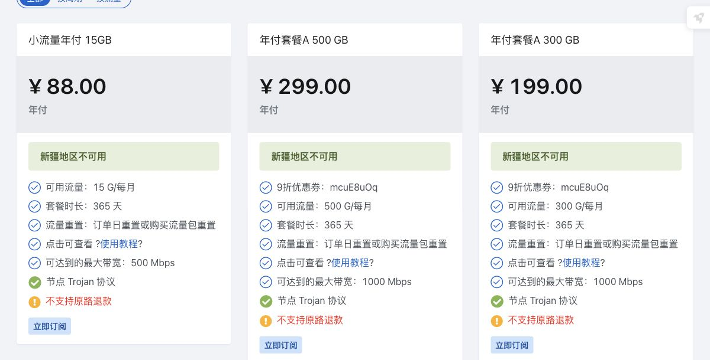

*大哥云套餐页，2026-10-29截图。*

### 主要特点包括

- **Trojan协议**：当前商品卡明确标注。
- **付款周期**：月付、季付及年付同时提供。
- **低用量年付**：88元整年，每月15GB。
- **大流量年付**：300GB／月和500GB／月两个档位。
- **重置方式**：配额按订单日重置，续费与重置包规则另看方案。

### 套餐详情介绍

套餐价格（2026-10-29）：

| 套餐 | 页面价格 | 付款周期 | 流量口径 | 补充说明 |
|---|---:|---|---|---|
| 单月A | ¥19.9 | 月付 | 100GB/月 | — |
| 季付A | ¥69 | 季付 | 200GB/月 | — |
| 小流量年付 | ¥88 | 年付 | 15GB/月 | — |
| 年付300GB | ¥199 | 年付 | 300GB/月 | — |
| 年付500GB | ¥299 | 年付 | 500GB/月 | — |

### 套餐选购建议

想逐月买，先看19.90元100GB；全年用量很轻，可以算88元年付；每月需求更大，再比较季度200GB和年付300GB、500GB。

商品卡标注Trojan，不支持原路退款。配额按订单日重置，不同方案对续费和重置包的说明有所区别，已有套餐时按具体订单处理。

### 客户端与使用说明

商品卡标示Trojan协议，面板有使用文档和订阅导入入口。未验证每个客户端或安装包。

---

## 14 · 星云-VPN

星云VPN是一家专注于提供高速稳定网络服务的机场VPN，以其出色的稳定性、高速网络和高性价比赢得了广泛好评。

[→ 星云 官网注册入口](https://www.xingyunjichang.com/#/register?code=ngwrsPY3)

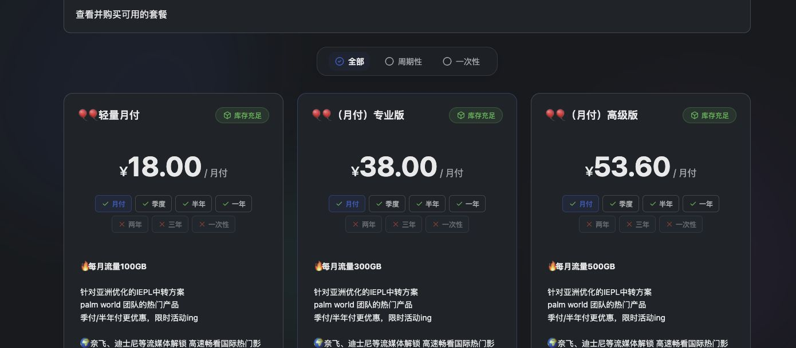

*星云套餐页，2026-10-29截图。*

### 主要特点包括

- **月付三档**：100GB、300GB、500GB。
- **年付分月配额**：五档为每月50GB—300GB。
- **一次性包**：不限时方案按总量给流量。
- **设备额度**：同时登录客户端数随方案变化，最低3台。
- **续费方式**：延长周期，不立即重置当前周期流量。

### 套餐详情介绍

套餐价格（2026-10-29）：

| 套餐 | 页面价格 | 付款周期 | 流量口径 | 补充说明 |
|---|---:|---|---|---|
| 轻量月付 | ¥18 | 月付 | 100GB/月 | 3台客户端 |
| 专业月付 | ¥38 | 月付 | 300GB/月 | 15台客户端 |
| 高级月付 | ¥53.6 | 月付 | 500GB/月 | 20台客户端 |
| 特惠年付600GB | ¥76 | 年付 | 50GB/月 | 3台客户端 |
| 年付Air1200GB | ¥116 | 年付 | 100GB/月 | 10台客户端 |
| 年付Plus1800GB | ¥146 | 年付 | 150GB/月 | 13台客户端 |
| 年付Pro2400GB | ¥176 | 年付 | 200GB/月 | 20台客户端 |
| 年付Ultra3600GB | ¥226 | 年付 | 300GB/月 | 30台客户端 |
| 不限时白银 | ¥48 | 一次性 | 200GB总量 | 3台客户端 |
| 不限时黄金 | ¥109 | 一次性 | 500GB总量 | 10台客户端 |
| 不限时钻石 | ¥279 | 一次性 | 1500GB总量 | 20台客户端 |
| 不限时王者 | ¥499 | 一次性 | 3200GB总量 | 30台客户端 |

### 套餐选购建议

普通月付方便逐月选择；年付适合用量稳定、能接受长期付款的情况；不限时包则按一次性总量算。几个方案的配额口径不同，别只比较标题里的GB数字。

设备数随档位变化。流量重置日也要留意：年付卡片写订单日，通用须知写常规套餐每月1日，购买前请确认自己那一档。续费延长周期，不重置当前流量。客户端按站内教程配置。

### 客户端与使用说明

商品页按客户端同时登录数区分档位，面板提供教程入口。当前客户端路线应以教程和实际下载页为准，本文未完成客户端安装。

---

## 15 · Taishan Net 泰山-VPN

Taishan Net（泰山-VPN）是一家由海外团队运营的-VPN服务，成立于2023年5月。它以高性价比著称，提供多种套餐，包括每月64GB和128GB的流量选项，当前64GB档为29元季付，128GB档为13元月付，另有256GB、512GB月付和一次性总量包。该-VPN支持多种流媒体解锁，包括YouTube、Netflix、Disney等，并且支持ChatGPT，付款方式：支持支付宝、微信和USDT付款。

[→ 泰山 TaiShan Net 官网注册入口](https://jp.taishan.app/register?code=YMe9G2bQ)

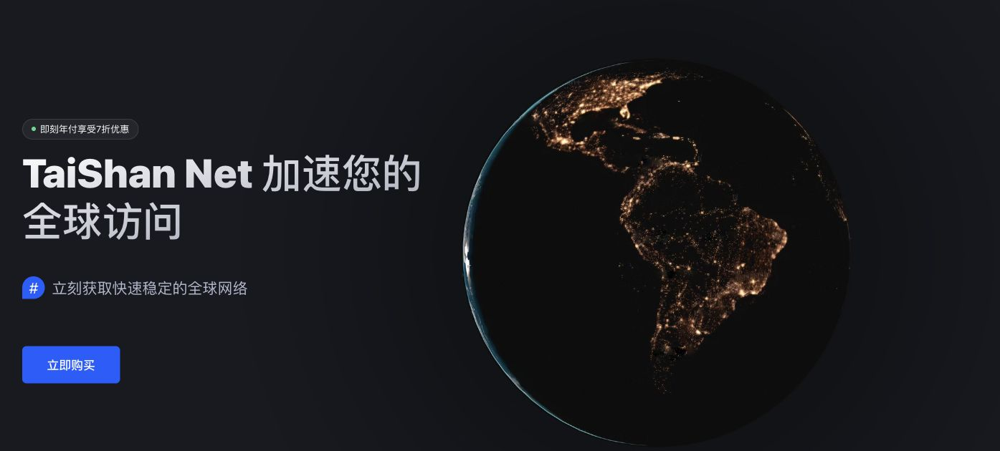

*泰山官网首页，2026-10-29截图。*

### 主要特点包括

- **轻量季付**：29元一季，每月64GB。
- **普通月付**：128GB、256GB、512GB。
- **按量备用**：200GB和600GB一次性总量包。
- **设备说明**：套餐标注不限制设备连接数。
- **付款方式**：购买页列支付宝、微信和虚拟币。

### 套餐详情介绍

套餐价格（2026-10-28）：

| 套餐 | 页面价格 | 付款周期 | 流量口径 | 补充说明 |
|---|---:|---|---|---|
| 轻量64G | ¥29 | 季付 | 64GB/月 | 标称200Mbps |
| 标准128G | ¥13 | 月付 | 128GB/月 | 标称300Mbps |
| 进阶256G | ¥24 | 月付 | 256GB/月 | 标称500Mbps |
| 高级512G | ¥42 | 月付 | 512GB/月 | 标称1000Mbps |
| 不限时200G | ¥78 | 一次性 | 200GB总量 | — |
| 不限时600G | ¥195 | 一次性 | 600GB总量 | — |

### 套餐选购建议

64GB轻量方案季度起购，29元是整季金额。需要逐月付费时，13元128GB的标准档是另一个选择；低频备用可以看一次性包。

页面明确无退款政策，支持支付宝、微信和虚拟币付款。设备连接数量按套餐说明，订阅分享仍要遵守服务条款。

### 客户端与使用说明

购买页提供服务文档与服务中心入口。当前域名由原注册入口自动跳转取得，域名可能继续变化。

---

## 16 · FLYINGBIRD 飞鸟-VPN

飞鸟-VPN是一个全员海外落地的ss-VPN，原文以全专线IPLC、不限速和流媒体支持作为主要卖点。目前，飞鸟加速器在全球超过70条优质线路，其节点遍布于亚洲、美洲和欧洲等国家和地区，如中国香港、中国台湾、日本、新加坡、马来西亚、土耳其、阿根廷和美国等，支持看奈飞Netflix/HULU/HBO/TVB/动画疯等国外流媒体视频，适用性按所选节点、套餐和客户端确认。

[→ 飞鸟 FlyingBird 官网注册入口](https://fbinv02.fbaff.cc/auth/register?code=F5eNanFW)

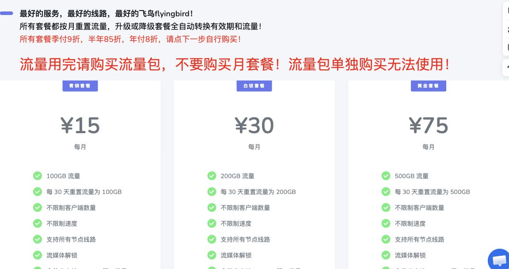

*飞鸟套餐页，2026-10-29截图。*

### 主要特点包括

- **四档基础套餐**：100GB、200GB、500GB、1000GB。
- **重置周期**：每30天重置流量。
- **临时补流量**：补充包须有有效基础套餐。
- **多系统客户端**：Windows、macOS、Android、Android TV、Linux、OpenWRT。
- **移动配置**：另有iOS教程，按本家当前版本操作。

### 套餐详情介绍

套餐价格（2026-10-28）：

| 套餐 | 页面价格 | 付款周期 | 流量口径 | 补充说明 |
|---|---:|---|---|---|
| 青铜 | ¥15 | 月付 | 100GB/30天 | — |
| 白银 | ¥30 | 月付 | 200GB/30天 | — |
| 黄金 | ¥75 | 月付 | 500GB/30天 | — |
| 钻石 | ¥150 | 月付 | 1000GB/30天 | — |
| 补充50G | ¥8 | 需有效套餐 | 50GB | 随当月套餐周期有效 |

### 套餐选购建议

按自己一个月大概用多少来选基础档，临时超量再比较补充包。8元50GB补充包需要已有有效套餐，并且跟着当月周期到期。

官方提供Windows、macOS、Android、Android TV、Linux、OpenWRT客户端，以及iOS教程。升级、降级会转换有效期和流量，操作前先看转换后的权益。

### 客户端与使用说明

首页公布v7.2.5专属客户端下载，覆盖Windows、macOS、Android、Android TV、Linux和OpenWRT，并提供iOS教程。

---

## 17 · Riolu 精灵学院-VPN

Riolu.443 精灵学院是一家2023年开业的代理订阅服务，原文介绍提供Shadowsocks、Vless+Reality、Hysteria、 超多协议节点支持，线路有直连也有隧道中转，套餐起步价格很便宜并有不限时长按量付费套餐提供。精灵学院需要挑选客户端使用，有的客户端是不支持新协议的。当前公开卡片标VLESS，具体协议按现行教程核对。

[→ 精灵学院 RioLU 官网注册入口](https://ok.riolu.work/register?aff=UoJu1HbO)

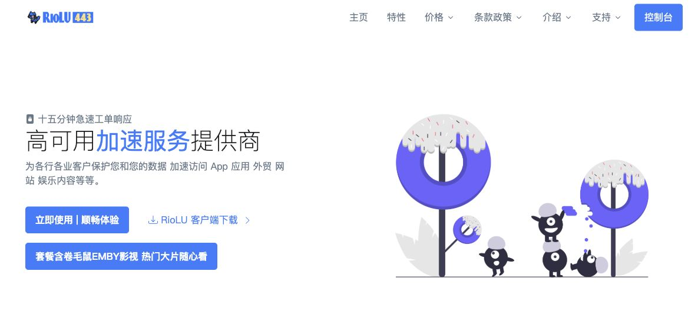

*精灵学院官网首页，2026-10-29截图。*

### 主要特点包括

- **轻量起步**：Iron公开卡片8元／月、30GB。
- **不限时选择**：Small400GB、Large800GB。
- **协议说明**：当前公开卡片标VLESS。
- **系统范围**：列有电脑、手机、平板、Linux和路由器配置。
- **报价差异**：部分卡片与静态表不一致，订单页需再次确认。

### 套餐详情介绍

套餐价格（2026-10-29）：

| 套餐 | 页面价格 | 付款周期 | 流量口径 | 补充说明 |
|---|---:|---|---|---|
| Iron | ¥8 | 按月展示价起 | 30GB/月 | — |
| Silver | ¥14 | 按月展示价起 | 120GB/月 | 静态表仍写15元，需结账确认 |
| Gold | ¥41 | 按月展示价起 | 360GB/月 | 静态表仍写45元，需结账确认 |
| Diamond | ¥68 | 按月展示价起 | 600GB/月 | 静态表仍写75元，需结账确认 |
| 不限时Small | ¥70 | 一次性 | 400GB总量 | — |
| 不限时Large | ¥130 | 一次性 | 800GB总量 | — |

### 套餐选购建议

上表保留按月开关下的卡片价。页面静态对比表仍写Silver15元、Gold45元、Diamond75元，和卡片的14／41／68元不一致，最终报价需要在订单页确认。

卡片标VLESS。设备规则也有冲突：表格写5台，FAQ又说目前不限制。默认个人使用，禁止合租、转借和转售，不支持原路退款；续费不直接重置当月流量。

### 客户端与使用说明

公开卡片标示VLESS，网站列出macOS、Windows、Android、iOS、iPadOS、Linux和路由器等支持范围；具体客户端版本按文档核对。

---

## 18 · 青云梯-VPN

青云梯-VPN成立于2021年, 多年沉淀；全IPLC专线，无倍率;

原文介绍支持Netflix、Disney+、HBO MAX等流媒体；

支持解锁ChatGPT、bing等ai工具；

覆盖的线路涵盖香港、台湾、日本、新加坡、美国、韩国、越南、菲律宾、泰国、印度、德国、法国、英国、阿根廷等地。

[→ 青云梯 官网注册入口](https://inv02.qytaff.cc/register?aff=39fyLAnm)

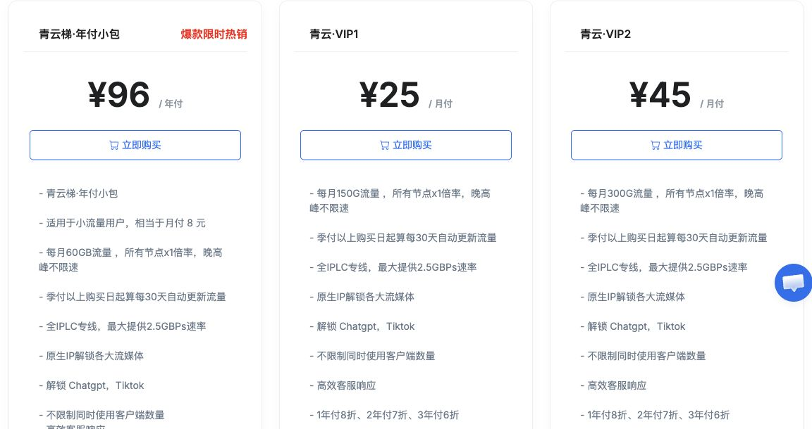

*青云梯套餐页，2026-10-29截图。*

### 主要特点包括

- **年付小包**：96元整年，每月60GB。
- **四档月付**：150GB、300GB、600GB、1000GB。
- **倍率说明**：产品卡写所有节点x1倍率。
- **周期重置**：季付及以上从购买日起每30天更新。
- **专属客户端**：当前公告要求v7.2.5极速版，并有iOS教程。

### 套餐详情介绍

套餐价格（2026-10-29）：

| 套餐 | 页面价格 | 付款周期 | 流量口径 | 补充说明 |
|---|---:|---|---|---|
| 年付小包 | ¥96 | 年付 | 60GB/月 | 全年付款，非8元可单月购买 |
| VIP1 | ¥25 | 月付 | 150GB/月 | — |
| VIP2 | ¥45 | 月付 | 300GB/月 | — |
| VIP3 | ¥85 | 月付 | 600GB/月 | — |
| VIP4 | ¥150 | 月付 | 1000GB/月 | — |

### 套餐选购建议

每月60GB够用、又能接受年付时，可以比较96元小包。折合8元/月只是算成本，实际仍需一次付96元。希望逐月选，就从VIP1开始看。

套餐说明节点x1倍率，季付及以上从购买日起每30天重置流量，更换套餐会覆盖旧方案。客户端当前要求v7.2.5极速版，提供Windows、macOS、Android、Android TV、Linux、OpenWRT版本及iOS教程。

### 客户端与使用说明

当前公告要求更新到v7.2.5专属客户端，列有Windows、macOS、Android、Android TV、Linux与OpenWRT下载，以及iOS教程；未安装测试。

---

## 19 · NiceDuck 好鸭-VPN

NiceDuck-VPN，全隧道中转线路，国内多入口，原文介绍过SLA与Emby等权益，是否仍包含需按当前商品页核对。

原文列出的支持平台包括ChatGPT/Netfilx/Disney+/Dazn/动画疯/Abema/DMM等

当前商品卡标VLESS，面板提供iOS、Android、macOS和Windows配置页签；其他系统以现行教程为准。

[→ 好鸭 NiceDuck 官网注册入口](https://x.niceduck.sh/register?code=GjNWEZyZ)

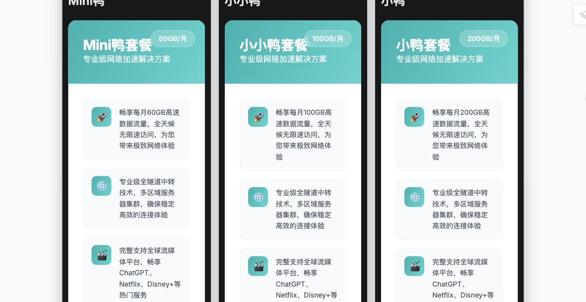

*好鸭套餐页，2026-10-29截图。*

### 主要特点包括

- **Mini季付**：26元一季，每月60GB。
- **普通月付**：100GB到1000GB分档。
- **当前协议**：本轮商品卡标VLESS。
- **四大系统配置**：iOS、Android、macOS、Windows页签。
- **Mac导入方式**：可见ClashX、Surge、Loon入口。

### 套餐详情介绍

套餐价格（2026-10-28）：

| 套餐 | 页面价格 | 付款周期 | 流量口径 | 补充说明 |
|---|---:|---|---|---|
| Mini鸭 | ¥26 | 季付 | 60GB/月 | — |
| 小小鸭 | ¥16 | 月付 | 100GB/月 | — |
| 小鸭 | ¥32 | 月付 | 200GB/月 | — |
| 中鸭 | ¥42 | 月付 | 300GB/月 | — |
| 大鸭 | ¥60 | 月付 | 500GB/月 | — |
| 超大鸭 | ¥95 | 月付 | 1000GB/月 | — |

### 套餐选购建议

月用量不超过60GB、能接受季度付款，可以看Mini；需要按月付款则看小小鸭。26元买的是一个季度、每月60GB，不是三个月总共60GB。

好鸭明确不退款、仅个人使用、禁止共享订阅。卡片标VLESS，面板有四大系统的配置页签；Mac页能看到ClashX、Surge和Loon导入入口。

### 客户端与使用说明

卡片标示VLESS。面板有iOS、Android、macOS、Windows配置页签，macOS页签可见ClashX、Surge、Loon导入入口。

---

## 20 · 龙猫云-VPN

龙猫云是一家成立于2023年的代理订阅服务，主要提供Shadowsocks和Trojan协议的节点，支持多种设备和操作系统，包括Android、iOS、macOS、Windows和Linux。该服务专注于为用户提供稳定、高速的翻墙服务，适用于解锁流媒体和AI服务，如Netflix、Disney+、ChatGPT等。

[→ 龙猫云 官网注册入口](https://inv06.lmaff01.cc/register?aff=62SG6k8G)

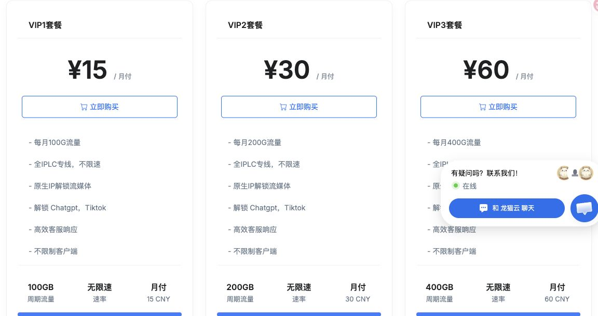

*龙猫云套餐页，2026-10-29截图。*

### 主要特点包括

- **四档普通VIP**：100GB、200GB、400GB、1000GB。
- **另行定制**：独享IP、独享带宽需另外咨询。
- **教程中心**：提供按系统查阅的配置入口。
- **客户端下载**：首页有官方客户端版本公告。
- **切换规则**：更换套餐会覆盖当前方案，已有权益先确认。

### 套餐详情介绍

套餐价格（2026-10-28）：

| 套餐 | 页面价格 | 付款周期 | 流量口径 | 补充说明 |
|---|---:|---|---|---|
| VIP1 | ¥15 | 月付 | 100GB/月 | — |
| VIP2 | ¥30 | 月付 | 200GB/月 | — |
| VIP3 | ¥60 | 月付 | 400GB/月 | — |
| VIP4 | ¥120 | 月付 | 1000GB/月 | — |

### 套餐选购建议

普通个人使用先选够用的VIP档。DIY定制标价680元/月，涉及独享出口等需求，购买前要单独沟通。

更换套餐会覆盖原方案。客户端下载和安装要求看本家的教程中心，已有套餐时先确认切换后的权益。

### 客户端与使用说明

面板提供教程中心和客户端页面，首页有官方客户端版本公告。下载与安装要求以本家当时的文档为准。

---

## 20 家服务入口总表

总表先列一款有代表性的方案。月付、季付和年付的付款金额分开写，详细配额与限制放在各家介绍里。

| 序号 | 服务 | 当前套餐样例 | 配额口径 | 详细介绍 |
|---|---|---|---|---|
| 01 | 云猫 CloudCat / 云猫科技 | ¥9.80／月付 | 150GB/月，5设备 | [查看介绍](#service-01) |
| 02 | 狗狗加速 Doggygo | ¥16.9／1个月 | 160GB | [查看介绍](#service-02) |
| 03 | 尔湾云 | ¥24.99／30天 | 100GB | [查看介绍](#service-03) |
| 04 | XSUS | ¥12／月付起 | 168GB/月 | [查看介绍](#service-04) |
| 05 | 纵云梯 | ¥52.5／月付（默认配置） | 100GB/月，3设备 | [查看介绍](#service-05) |
| 06 | 极客云 | ¥19.99／月付 | 100GB | [查看介绍](#service-06) |
| 07 | 八戒 | ¥12.9／月付；体验包另计 | 70GB/月 | [查看介绍](#service-07) |
| 08 | WgetCloud | ¥357／90天季付 | 230G/30天 | [查看介绍](#service-08) |
| 09 | WCloud | ¥9.6／月付 | 108GB/月 | [查看介绍](#service-09) |
| 10 | 咖啡云 CoffeeCloud | ¥16／月付 | 100GB/月 | [查看介绍](#service-10) |
| 11 | 奶优 NaiU_Net | ¥31／季付 | 50GB/月 | [查看介绍](#service-11) |
| 12 | 泡泡Dog | ¥15.4／月付 | 88GB/月 | [查看介绍](#service-12) |
| 13 | 大哥云 | ¥19.9／月付 | 100GB/月 | [查看介绍](#service-13) |
| 14 | 星云 | ¥18／月付 | 100GB/月 | [查看介绍](#service-14) |
| 15 | 泰山 TaiShan Net | ¥29／季付 | 64GB/月 | [查看介绍](#service-15) |
| 16 | 飞鸟 FlyingBird | ¥15／月付 | 100GB/30天 | [查看介绍](#service-16) |
| 17 | 精灵学院 RioLU | ¥8／按月展示价起 | 30GB/月 | [查看介绍](#service-17) |
| 18 | 青云梯 | ¥96／年付 | 60GB/月 | [查看介绍](#service-18) |
| 19 | 好鸭 NiceDuck | ¥26／季付 | 60GB/月 | [查看介绍](#service-19) |
| 20 | 龙猫云 | ¥15／月付 | 100GB/月 | [查看介绍](#service-20) |

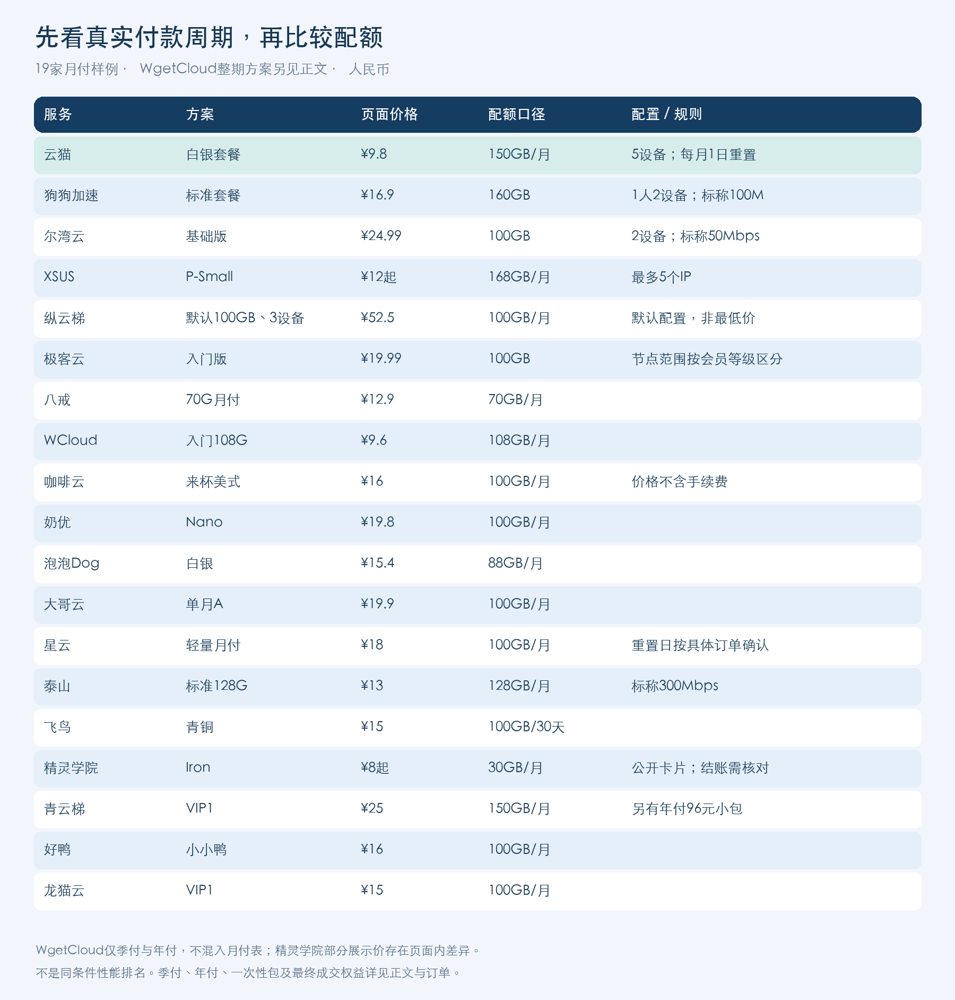

这张图方便比较月付预算。季度起购、年付和一次性包请看下方详细表，WgetCloud的整期方案另有配图。

## 选择合适工具的关键考量

### 使用场景与需求分析

不同的使用场景对网络工具有不同要求：

- **流媒体观看**：确认Netflix、Disney+等目标平台、地区与节点，按观看频率估算流量。
- **AI工具与日常查资料**：核对目标平台的账号、地区和出口要求，别只凭“支持AI”判断。
- **商务、会议与远程工作**：更关注持续连接、上传、延迟与故障后的支持方式。
- **旅行与多地区访问**：确认目的地网络下的可用性、设备和常用服务，不能只看节点总数。
- **路由器、家庭与多设备**：先看硬件和协议是否兼容，再区分个人设备额度与多人共享规则。

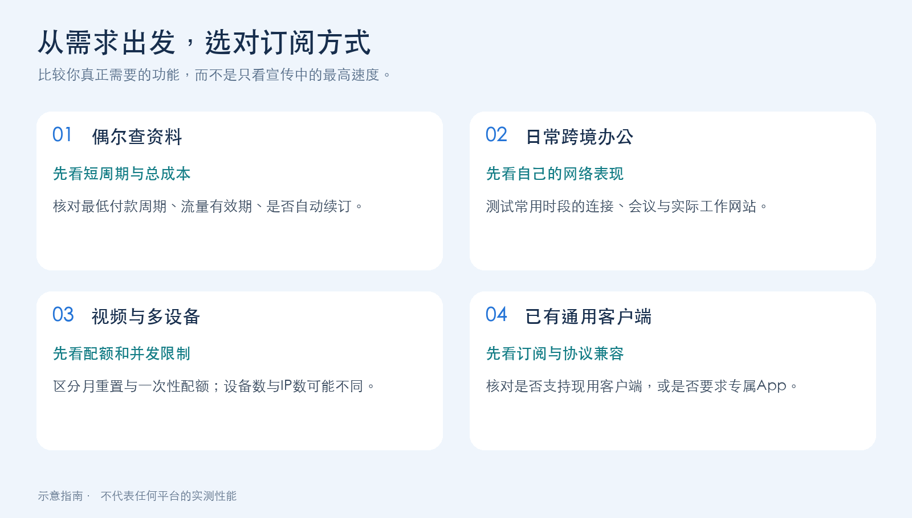

### 预算与性价比考量

- **初次使用**：优先比较短周期或明确列出的体验包，先确认是否适合自己的网络。
- **长期使用**：比较年付等长周期的实付总额与配额，再计算折合成本。
- **低频备用**：可比较不限时包，但总量、有效期与重复购买规则要分别看。
- **额外费用**：客户端、手续费、补充流量和定制出口均可能另计。
- **退款与切换**：读本家退款、续费及套餐覆盖规则，不把站内余额当作原路退款。

### 技术兼容性与客户端下载

确保所选工具与自己的设备和网络环境兼容：

- 检查Windows、macOS、iOS、Android、Linux及路由器等所需平台是否有教程。
- 服务商要求专属App时，按本家说明下载；支持通用订阅时，再核对Clash系、sing-box、v2rayN、Shadowrocket等客户端与协议格式。
- 同时在线设备数、公网IP数和并发连接数是三种不同限制，按本家解释计算。
- 有按域名、地区、进程或应用分流等需求时，先确认所用客户端及版本是否支持。
- 路由器另查硬件、固件和排障要求；iOS应用另看商店地区和费用。

下载优先使用官方项目或系统应用商店。个人订阅地址只用于自己的配置，不要贴进公开Issue。

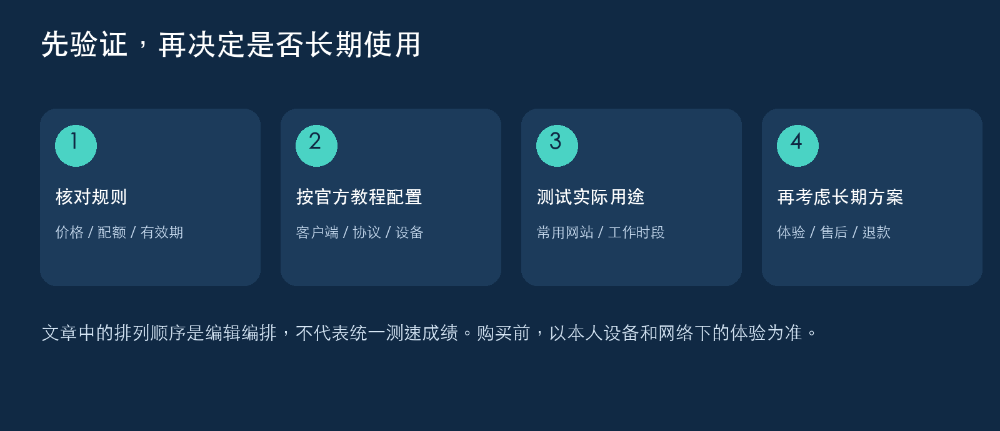

### 评选标准与方法论

选择时可从稳定性、速度、套餐与技术支持等方面比较。完整说明见[docs/methodology.md](docs/methodology.md)。下面是选购维度，不是已经完成的统一实测评分。

1. **连接稳定性**：在常用网络和时段能否连续使用，发生中断后怎样恢复。
2. **连接速度**：下载、上传、延迟与丢包是否满足任务，不能用标称带宽代替实测。
3. **性价比**：比较实付金额、配额、重置规则、设备限制和额外费用。
4. **安全性**：查运营主体、隐私政策、日志说明与审计范围，区分承诺和独立证据。
5. **技术支持**：看客服时间、支持的系统及教程能否帮助完成配置和排障。

### 机场和VPN怎么按场景选

- **希望少配置**：比较有专属App的商业VPN或代理服务，确认目标地区可用和退款规则。
- **视频、游戏、AI工具**：比较目标节点的实际用途、延迟、丢包和平台可用性。
- **全屋路由器连接**：确认服务商提供兼容固件和协议的教程，再看分流方式与设备性能。
- **更关注隐私**：查看日志政策、运营主体和独立审计的日期与范围，不把“无日志”宣传当作匿名保证。

如果持续连接对工作很重要，可评估独立备用服务及成本。两个品牌也可能共用上游线路，买两份订阅并不自动获得独立保障。

### 项目维护与更新

本项目持续整理服务入口、价格、配额与客户端资料：

- [data/services.json](data/services.json)：20家服务的入口与顺序。
- [data/product-plans.json](data/product-plans.json)：套餐、付款周期、配额及核对日期。
- [SOURCES.md](SOURCES.md)：官网来源及尚待确认的页面差异。
- [CHANGELOG.md](CHANGELOG.md)：已完成的更新记录。
- [CONTRIBUTING.md](CONTRIBUTING.md)：欢迎提交失效链接、价格及使用说明纠错。

资料经人工核对后更新；目前未启用自动测速或实时监测。

文字参考与许可见[NOTICE.md](NOTICE.md)。

---

## 常见问题

### 第一次买，选月付还是年付？

先选你能接受的短周期，或者明确列出的体验包。网络体验满意后再决定是否长期续费。年付便宜多少，要按整期付款和实际配额算，别只看折合月价。

### 不限时包是不是更划算？

看使用频率。不限时包给的是一次性总量，周期套餐则按规则补流量。比如云猫198元总计260GB，与黄金18元每月260GB，适合的是两种不同用法。

### 哪一家速度最快？

这里没有统一测速排名。地区、运营商、节点和时段都会影响结果，自己的常用网络和实际用途更有参考价值。

### 注册后就能连接吗？

通常还需要开通套餐、下载客户端和导入配置，按各家的教程操作。免费账户或注册成功不等于已经有可用套餐。

### 链接打不开怎么办？

先找已确认的官网公告或地址发布页，留意域名变更。部分注册入口尚未完成邀请绑定测试；不要把账户密码或订阅地址发到公开Issue。

### 能长期保证某个AI工具或流媒体可用吗？

服务商的支持名单可作选购参考，实际还受平台规则、账号、地区和出口节点影响。具体用途先试清楚，再决定长期方案。

## 资料来源与更新

套餐资料整理于2026-10-28—29，来源是各家的官网、购买页和帮助文档。

文字参考与许可见[NOTICE.md](NOTICE.md)。具体链接及页面内的价格、规则差异见 [SOURCES.md](SOURCES.md)，完整数据见 [套餐记录](data/product-plans.json)和[入口索引](data/services.json)。

服务简介摘录或改编自参考文章，线路、节点、解锁及口碑描述属于原文说法，并非本文实测。本文按官网资料比较产品，不包含节点测速、客户端安装、隐私审计或流媒体实测。配图包括原创插画、套餐信息图和本次采集的官网页面截图；未搬用他人的测评图片。

发现价格变化或入口失效，可以提交Issue，附上公开来源和日期；请勿附个人账号、订阅链接或付款信息。

---

推广说明：本文包含推广链接。通过这些链接注册或购买服务，我们可能获得佣金。
